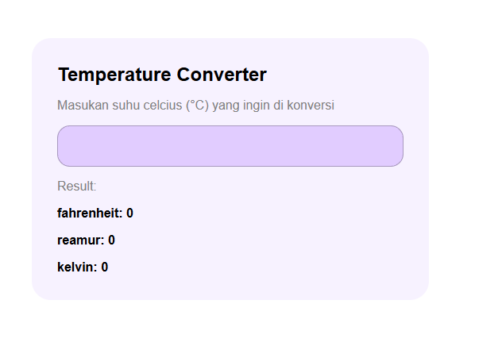
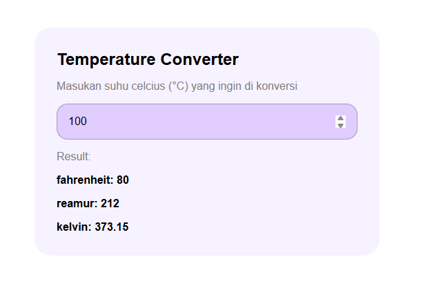

# DOM Minitask 1
on this repo i learn how to manipulate the content
inside html list tag and get an input and listen to an event of input with type number, and change the list tag content to be realtime changes depends on inputs

### Demo (refactor)

### Results

